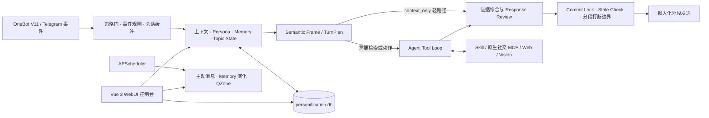

# Personification · 拟人化聊天运行时

[](https://www.python.org/)
[](https://nonebot.dev/)
[](#环境要求)
[](#webui-管理与取证控制台)

> 面向 **NoneBot 2**（OneBot V11 & 可选 Telegram）的群聊拟人化 Agent 插件。它不只是给大模型套一层系统提示词，而是把**参与决策、多消息批次与指代消解、长期记忆与关系演进、多步工具与多模态理解、拟人化分段发送、主动社交、QQ 空间一致性账本与三主题 WebUI 取证控制台**组合成一套完整的生产级运行时。

**目录导航**：[双轨仓库](#双轨仓库说明) · [设计原则](#设计原则) · [核心能力](#主要能力) · [运行架构](#运行架构) · [安装与配置](#环境要求) · [模型与路由](#provider-与模型路由) · [命令速查](#qq-命令) · [WebUI 控制台](#webui-管理与取证控制台) · [QQ 空间一致性](#qq-空间一致性) · [Skill 与社交查梗 MCP](#skill-与-mcp) · [专题文档](#专题文档索引) · [开发与验证](#开发与验证)

---

## 双轨仓库说明

当前仓库是源码型插件，默认放在宿主 NoneBot 项目的 `plugin/personification`，由 `plugin_dirs = ["plugin"]` 自动加载：

| 轨道 | 仓库 / 包名 | 说明 |
|---|---|---|
| **本地开发版** | [`luojisama/personification`](https://github.com/luojisama/personification) | 代码目录 `plugin/personification`，导入命名空间 `plugin.personification` |
| **商店发布版** | [`luojisama/nonebot-plugin-personification`](https://github.com/luojisama/nonebot-plugin-personification) | 独立插件发布仓库，经发布适配同步后打包 |
| **PyPI 发布包** | [`nonebot-plugin-shiro-personification`](https://pypi.org/project/nonebot-plugin-shiro-personification/) | 面向商店与 `pip` 安装的正式发行包 |

两者使用相同的用户可见插件名「拟人化聊天」，但目录、导入命名空间和发布渠道不同；本仓库的源码更新需经过发布版适配后打包发布。

---

## 设计原则

- **LLM 全决策（No Keyword Routing）**：对话语义由模型决定。代码只负责事实、上下文、权限、预算、契约、持久化和安全兜底，不用关键词表或正则代替「要不要回复、用户在说什么、该调用什么工具、证据够不够」等语义判断。
- **快慢双轨与分层预算**：日常无需外部工具与动作的对话自动走[无工具轻路径](docs/context-only-chat.md)降低延迟；复杂请求进入 `TurnPlan`、Agent tool loop 与可选 response review，模型可自由回复、追问、查证、执行动作或保持沉默。
- **外部副作用显式契约**：具有外部副作用的工具必须声明 `side_effect`、`final_behavior` 和 `retryable`；成功外发后可静默收尾，杜绝重复发送。
- **会话并发与防串话边界**：回复提交具备 session lock、generation-scoped 分段协作打断、stale check 和抢占边界，降低慢回复插入错误话题或同轮重复外发的风险。
- **不确定状态绝不盲目重放**：QQ 空间发布与群内 Peer Bot 协作均使用持久化账本（Operation Ledger / Outbound Ledger）。结果不确定时保持 `unknown`，禁止自动重发，优先远端精确对账。
- **高风险能力默认关闭**：QQ 空间、TTS、主动社交（Social Intelligence）、远程 Skill、插件代调用、共同经历与发言时效开关默认关闭，均受主开关、额度、冷却与权限边界约束。

---

## 主要能力

| 领域 | 当前能力 |
|---|---|
| **群聊、私聊与多平台** | 白名单群、私聊、被 @、引用、随机插话、戳一戳、多人并行话题、同用户跨消息指代承接、短期 thread state、回复缓冲与过期提交拦截；支持 [Telegram 网页托管与 NoneBot 原生双模接入](docs/telegram-integration.md)、Topic 隔离及跨平台账号绑定共享上下文 |
| **Agent 决策与执行** | `TurnPlan`、`speech_act`、无工具轻路径、工具动态筛选、多步 tool call、证据综合、Provider 缓冲流式（Buffered Streaming）、[Peer Bot 双轨协作](docs/platform-acceptance-2026-09-06.md)、预算 `shadow`/`adaptive` 与全链路 Trace |
| **人设、记忆与关系** | 全局/群人设、角色模板构建、群风格学习、[分层记忆与全局场景记忆](docs/global-scene-memory-update.md)、记忆宫殿（Memory Palace）、用户画像、结构化画像更正、支持负数的真实好感度曲线与 inner state、可选[共同经历与发言时效判断](docs/experience-and-timeliness.md) |
| **联网与内置工具** | Provider 原生搜索、免配置搜索引擎链（萌娘百科/必应国内秒级响应优先、一键并发测速与自动延迟排序）、Web Search（8s 硬性熔断保护）、Web Fetch、Wiki（萌娘百科优先+并发抽取）、天气、新闻、游戏信息、ACG 实体解析、资源与图片检索、用户任务 |
| **多模态与媒体理解** | 图片输入、Bot 自身头像二创/同人自知交互、GIF 采样理解、群视频与社交视频多模态理解（原生视频 / 72·120·168 帧双遍抽帧拼图 / 字幕与云端 ASR）、视觉强锚点验真与确定性兜底、图片生成、表情包语义选择/发送/打标/整理 |
| **拟人化发送** | 按生成耗时补足打字延迟、大模型智能短消息分段（Message Splitter，支持独立模型路由与语义断句防硬切）、可变 `reply_shape`、引用、@、消息 reaction、拍一拍、私聊输入状态和可选低概率错别字 |
| **主动社交行为** | 主动私聊、早晚问候、新闻推送、话题跟进、节日祝福、群空闲话题、[Telegram 主动表达](docs/telegram-proactive.md)与状态驱动的主动互动 |
| **QQ 空间（QZone）** | 多 Bot 凭据隔离、QR 扫码登录、自动/手动说说、好友动态点赞评论、评论回响、转发、月度额度、幂等发布、远端精确对账、历史漏记补记与群友空间受控工具 |
| **WebUI 管理与观测** | Vue 3 事件取证与管理控制台（**默认 / BA Schale / 终末地 PRTS** 三套主题）、配置热更新、Provider 池与用途模型绑定、功能体检与六类路由能力探针、[聊天实验室](docs/quality-lab.md)、Token 计费统计、Agent 状态、Trace 时间线、受控禁言、数据迁移和五源并发测速更新 |

---

## 运行架构



### 核心目录职责

| 目录 | 职责 |
|---|---|
| [`agent/`](agent/) | Agent runtime、planner、tool loop、reply quality 综合审阅、ToolRegistry、inner state |
| [`core/`](core/) | Provider/模型路由、配置注册表、数据库、Memory、Persona、QZone、路由能力探针、诊断与安全边界 |
| [`handlers/`](handlers/) | NoneBot matcher、消息采集、普通/YAML reply pipeline、命令体系与拟人化发送 |
| [`flows/`](flows/) | 主动消息、日记/说说、QQ 空间社交及其它跨步骤业务流 |
| [`jobs/`](jobs/) | APScheduler 定时任务注册与后台任务构建 |
| [`skills/skillpacks/`](skills/skillpacks/) | 内置 Skill 声明、工具实现与使用说明 |
| [`skill_runtime/`](skill_runtime/) | 内置、本地、远程、隔离进程与 MCP Skill loader |
| [`native_mcp/`](native_mcp/) | 内置原生社交平台查梗 MCP（B站、抖音、贴吧、小黑盒只读查证） |
| [`webui/`](webui/) | FastAPI v1/v2 路由、Vue 3 前端工程（`webui/frontend`）、生产构建产物（`webui/frontend_dist`）与兼容静态页 |
| [`tests/`](tests/) | 单元、契约、路由、前端、静态门禁与脱敏回放测试集 |

更详细的目录与扩展规范见 [DIRECTORY_GUIDE.md](DIRECTORY_GUIDE.md)。

---

## 环境要求

- **Python**：`>=3.9,<4.0`
- **NoneBot 2**：`>=2.4.4`，使用 FastAPI Driver（`DRIVER=~fastapi`）
- **协议适配器**：OneBot V11 `>=2.4.6`（NapCat、Lagrange.OneBot、LLOneBot、go-cqhttp 等）；Telegram 接入可选安装 `nonebot-adapter-telegram==0.1.0b20`
- **硬依赖**：`nonebot-plugin-apscheduler`（缺失时插件拒绝加载）
- **持久化与渲染**：SQLite（安装 `aiosqlite` 时使用异步访问，否则使用运行时 fallback）；HTML 渲染、图片卡片或原生社交平台 MCP 需安装 Playwright Chromium

在宿主项目根目录安装完整依赖：

```powershell
python -m pip install -e .
python -m playwright install chromium
```

若单独将本仓库接入其它 NoneBot 项目，至少安装以下基础运行依赖（按实际启用的媒体、Telegram 和 Skill 能力补充可选依赖）：

```powershell
python -m pip install "nonebot2[fastapi,httpx]>=2.4.4" "nonebot-adapter-onebot>=2.4.6" "nonebot-plugin-apscheduler>=0.5.0" "nonebot-plugin-htmlrender>=0.3.6" "nonebot-plugin-alconna>=0.62.0" "nonebot-plugin-uninfo>=0.11.0" "nonebot-plugin-localstore>=0.7.4" "aiohttp>=3.10.0" "aiosqlite>=0.20.0" "ruamel.yaml>=0.18.0" "python-dateutil>=2.9.0" "Pillow>=10.4.0" "qrcode>=8.0,<9.0" "python-multipart>=0.0.20" "pillow-avif-plugin>=1.5.2" "filelock>=3.13.1" "openai>=1.50.0" "google-generativeai>=0.8.0" "anthropic>=0.30.0" "playwright>=1.50.0" "watchdog>=4.0.0" aiofiles beautifulsoup4 emoji imageio-ffmpeg msgspec yt-dlp
```

---

## 安装与启动

在 NoneBot 项目根目录执行：

```powershell
git clone https://github.com/luojisama/personification.git plugin/personification
```

确认项目的 `pyproject.toml` 包含：

```toml
[tool.nonebot]
plugin_dirs = ["plugin"]

[tool.nonebot.adapters]
nonebot-adapter-onebot = [
    { name = "OneBot V11", module_name = "nonebot.adapters.onebot.v11" }
]
```

启动 Bot：

```powershell
nb run
```

启动日志应出现拟人插件运行时初始化、Skill 加载和 WebUI 路由挂载信息。WebUI 仅在 FastAPI Driver 下挂载；其它 Driver 会跳过 WebUI，但不影响聊天 matcher。

---

## 最小配置

以下示例使用一个 OpenAI-compatible Provider。`personification_api_pools` 必须写成单行 JSON，避免 dotenv 对多行 JSON 截断：

```dotenv
DRIVER=~fastapi
HOST=127.0.0.1
PORT=8080
SUPERUSERS=["123456789"]

personification_whitelist=["987654321"]
personification_api_pools=[{"name":"primary","api_type":"openai","api_url":"https://example.com/v1","api_key":"replace-me","model":"your-model","priority":0}]
```

不使用 Provider pool 时可保留 legacy 单 Provider 配置：

```dotenv
personification_api_type=openai
personification_api_url=https://example.com/v1
personification_api_key=replace-me
personification_model=your-model
```

> **安全提示**：API Key、OAuth credential 和 QQ 空间 Cookie 均属 secret，严禁提交到 Git。推荐首次启动后通过 WebUI「配置中心」管理；运行时配置会原子持久化到插件数据目录并在重启时恢复，脱敏接口不会向浏览器回传明文密钥。

---

## Provider 与模型路由

支持以下 `api_type`：

| `api_type` | 鉴权方式 | 备注 |
|---|---|---|
| `openai` | `api_url` + `api_key` | OpenAI-compatible Chat / Responses 路由 |
| `gemini` | `api_url` + `api_key` | Gemini 官方或兼容路由 |
| `anthropic` | `api_url` + `api_key` | Anthropic Messages 标准路由 |
| `openai_codex` | Codex OAuth | 默认查找 `~/.codex/auth.json`，可指定 `personification_codex_auth_path` |
| `gemini_cli` | Gemini CLI OAuth | 默认查找 Gemini credential，可指定 auth path / project |
| `antigravity_cli` | Antigravity / Gemini OAuth | 支持独立 proxy、auth path 与 project |

> **移除说明**：历史 `claude_code`、`claude_cli` 与 `claudecode` Provider 已移除。检测到旧值时会以非调用 tombstone `provider_type_removed` 禁用并给出迁移提示，不会读取旧 OAuth CLI 凭据或自动转发请求。需要 Claude 模型时，请改用标准 `anthropic` API。

- **多 Provider 池与模型目录**：Provider pool 每项支持配置多个模型目录（`models`）、默认模型（`default_model_id`）、优先级、超时、重试、代理、原生搜索与订阅额度检测，正常聊天按优先级 fallback、失败冷却并动态健康排序。
- **按用途绑定模型**：可通过 `personification_model_purpose_bindings` 或 `personification_model_overrides` 为 `agent`、`intent`、`review`、`sticker`、`lite` 等不同阶段绑定最合适的 Provider 与模型（详见[模型目录与补充说明](docs/supplement-and-model-catalog.md)）。

---

## 关键配置

Config 模型当前包含数百个字段。下方仅列出启动、记忆与高风险边界；完整字段、默认值、类型、scope、热更新状态和风险说明以 WebUI「配置中心」或命令 `拟人 配置 列表` 为准。

### 基础聊天

| 配置 | 默认值 | 作用 |
|---|---:|---|
| `personification_whitelist` | `[]` | 允许插件参与的群号；私聊不受群白名单限制 |
| `personification_global_enabled` | `true` | 全局聊天总开关 |
| `personification_probability` | `0.30` | 非明确呼叫场景的参与概率基础值 |
| `personification_meme_reply_probability` | `0.18` | 已决定回复后，自然带入匹配语境的低风险 `verified/manual_locked` 梗的概率（不提高随机发言率） |
| `personification_agent_enabled` | `true` | 启用完整 Agent tool loop |
| `personification_agent_max_steps` | `10` | 单轮 Agent 最大步骤 |
| `personification_agent_budget_mode` | `shadow` | `shadow` 仅观测预算；`adaptive` 才接管实际步数和 deadline |
| `personification_response_timeout` | `180` | 单轮回复总超时秒数 |
| `personification_reply_session_concurrency` | `3` | 单 session 并发上限 |
| `personification_reply_global_concurrency` | `12` | 全局回复并发上限 |
| `personification_system_prompt` | 内置群友人设 | 默认系统人设，可改用 prompt file |
| `personification_timezone` | `Asia/Shanghai` | 作息、任务和日期工具时区 |

### Memory、Persona 与观测

| 配置 | 默认值 | 作用 |
|---|---:|---|
| `personification_memory_enabled` | `true` | 长期 Memory 总开关 |
| `personification_memory_palace_enabled` | `true` | Memory Palace 与关系图谱能力 |
| `personification_memory_rag_enabled` | `true` | 长期 Memory 检索注入 |
| `personification_memory_decay_enabled` | `true` | Memory 衰减任务 |
| `personification_memory_consolidation_enabled` | `true` | Memory 整合与结晶 |
| `personification_persona_enabled` | `true` | 用户画像生成与注入 |
| `personification_favorability_enabled` | `true` | 用户/群好感度 |
| `personification_turn_trace_enabled` | `true` | 记录 Agent 阶段 Trace |
| `personification_data_dir` | LocalStore 目录 | 显式指定全部插件运行数据目录 |

### 默认关闭或高风险能力

| 配置 | 默认值 | 启用前确认 |
|---|---:|---|
| `personification_qzone_enabled` | `false` | 会读取或写入真实 QQ 空间，先完成 QR 登录和额度设置 |
| `personification_tts_enabled` | `false` | 需要 TTS API Key，可能产生外部费用 |
| `personification_social_intelligence_enabled` | `false` | 会主动向用户或群发送消息 |
| `personification_plugin_invoker_enabled` | `false` | 允许 Agent 触发其它插件命令，应配置 allowlist/blocklist |
| `personification_plugin_knowledge_build_enabled` | `false` | 会后台扫描插件并调用模型构建知识 |
| `personification_skill_remote_enabled` | `false` | 会下载远程 Skill；默认还要求管理员审批和隔离执行 |
| `personification_skill_allow_unsafe_external` | `false` | 开启后外部 Skill 可进入宿主进程，不建议开启 |
| `personification_git_auto_update` | `false` | 会定时拉取源码，更新后仍需重启 |
| `personification_humanize_typo_probability` | `0.0` | 非零时闲聊可能故意产生并修正错别字 |
| `personification_humanize_proactive_poke_enabled` | `false` | 会主动拍一拍 |

> 注意：部分子功能默认值为 `true`，但仍受其上层 master switch 约束。例如 QZone proactive/social/inbound 的默认值不会绕过 `personification_qzone_enabled=false`。

---

## QQ 命令

命令受 NoneBot `command_start` 影响。统一入口支持中文 `拟人`、`人格` 和英文 `/persona`；最准确的在线帮助始终是：

```text
拟人 帮助
```

### 统一管理入口

| 命令 | 权限 | 用途 |
|---|---|---|
| `拟人 帮助 [分类/配置项]` | 可用用户 | 命令总览、分类帮助或字段说明 |
| `拟人 状态` | 管理员 | 运行、Memory、联网和后台状态 |
| `拟人 配置 列表 [全局/群]` | 管理员 | 列出配置、当前值、默认值和 scope |
| `拟人 配置 查看 <配置项> [当前群/群号]` | 管理员 | 查看字段详情和风险 |
| `拟人 配置 设置 <配置项> <值> [当前群/群号]` | 管理员 | 热更新或持久化配置 |
| `拟人 配置 重置 <配置项> [当前群/群号]` | 管理员 | 恢复默认值 |
| `拟人 管理员 列表/添加/删除` | Superuser | 管理插件管理员 |
| `拟人 记忆 状态/补建/衰减/演化/结晶 执行` | 管理员 | Memory 运维 |
| `拟人 迁移 状态/执行` | 管理员 | 旧数据迁移 |
| `拟人 召回 统计` | 管理员 | 长期 Memory recall 统计 |
| `拟人 模型 列表/路由/使用/设置/重置` | 管理员 | Provider 与阶段模型热切换 |
| `拟人 定时 状态` | 管理员 | APScheduler job、下次执行和开关 |
| `拟人 空间 状态/测试/消息` | 管理员 | QZone 状态、指定好友测试和留言轮询 |
| `拟人 表情包 整理/清理/回滚` | 管理员 | 表情包维护 |
| `拟人 人设构建 <作品名> <角色名>` | 管理员 | 从资料构建 Persona template |
| `拟人 更新` | Superuser | 并发测速检查并拉取插件更新 |

### 常用兼容命令

| 命令 | 权限 | 用途 |
|---|---|---|
| `开启拟人` / `关闭拟人` | Superuser | 当前群聊天开关 |
| `开启表情包` / `关闭表情包` | Superuser | 当前群表情包开关 |
| `开启语音回复` / `关闭语音回复` | Superuser | 当前群语音开关 |
| `拟人开关` / `拟人语音` / `拟人联网` / `拟人主动消息` | Superuser | 全局快速开关 |
| `拟人作息` | Superuser | 当前群或全局作息模拟 |
| `设置人设` / `查看人设` / `重置人设` | Superuser | 群 Persona 管理 |
| `学习群聊风格` | Superuser | 重新分析当前群风格 |
| `查看群聊风格 [群号]` | 可用用户 | 查看已保存的群风格 |
| `群好感` / `群好感度` | 群成员 | 查看当前群好感度 |
| `设置群好感 [群号] [数值]` | Superuser | 修改群好感度 |
| `查看画像` / `刷新画像` | 白名单内用户 | 查看或重建自己的画像 |
| `清除记忆` / `完全清除记忆` | Superuser | 清理指定或全部会话与长期 Memory |
| `申请白名单` | 群成员 | 申请当前群接入 |
| `同意白名单` / `拒绝白名单` / `添加白名单` / `移除白名单` | Superuser | 群准入管理 |
| `永久拉黑` / `取消永久拉黑` / `永久黑名单列表` | Superuser | 用户封禁管理 |
| `发个说说` | Superuser | 生成并发布一条 QQ 空间说说 |
| `说` / `朗读` / `配音` | 可用用户 | 显式 TTS；支持 mode、voice、style、clone 参数 |
| `重打标表情包 [筛选词]` | Superuser | 后台重新生成表情语义标签 |
| `远程技能审批` / `安装远程技能` | Superuser | 远程 Skill 管理 |
| `重建/删除/清空插件知识库` | Superuser | Plugin Knowledge 运维 |
| `拟人额度` / `拟人统计` | Superuser | Provider quota 与运行统计 |

---

## WebUI 管理与取证控制台

FastAPI Driver 启动后，可通过以下入口访问：

- **新版 Vue 3 控制台（推荐）**：`http://<host>:<port>/personification/frontend/`
- **旧版兼容入口**：`http://<host>:<port>/personification/`

默认 `HOST=127.0.0.1` 时仅本机可访问。若 `HOST=0.0.0.0`，日志会输出局域网访问提示；公网部署强烈建议使用 HTTPS 反向代理，不要直接暴露明文 HTTP。

### 三套内置视觉主题

WebUI 内置三套完整主题，可在登录页右上角「外观设置」或侧栏底部随时无感切换：

1. **默认（Minimal）**：高密度现代运维工作台，支持**跟随系统 / 浅色 / 深色**模式与 **海蓝、青绿、鸢尾、琥珀、玫瑰** 5 套强调色。
2. **BA（Schale）**：明亮清透的蔚蓝学院终端风格，毛玻璃浮层、斜切胶囊导航与蔚蓝/暖金点缀（固定浅色）。
3. **终末地（PRTS）**：高对比工业战术终端风格，直角切角面板、警示斜纹、角标刻度与等宽遥测字体（固定深色）。

### 七大导航分区

| 分区 | 涵盖页面 |
|---|---|
| **运行概览** | 运行总览（健康度、活跃回合、p95 延迟、路由能力分布、恢复队列、最近 Trace、待核对诊断）、Agent 状态、Token 计费统计 |
| **调试与恢复** | 功能体检、聊天实验室（A/B/C 候选盲评与数据集对比）、模型与视频测试、路由能力（六类在线探针与音视频样例探测）、主动行为诊断、消息 Trace 时间线、恢复队列 |
| **画像与群聊** | 用户画像、群信息（群成员、好感度、Peer Bot 协作、群空间 Agent 授权）、群开关、受控禁言 |
| **记忆与表达** | Agent 记忆、记忆宫殿（图谱、召回测试、向量重建）、共同经历卡、表情包管理、人设预览、角色模板构建 |
| **能力与插件** | Skill 管理、MCP 管理（托管 Registry 安装与原生社交查梗 MCP）、创建工具、插件知识库、插件管理与多源测速更新 |
| **QQ 与社交** | QQ 空间（功能状态、扫码登录、读取检查、发布与互动、Operation 对账与历史补记）、QQ 账号与好友管理 |
| **系统与数据** | 配置中心（支持 `revision` 原子保存、Provider 池、用途模型绑定、Token 自定义价格）、Telegram 接入、用户策略与黑名单、近期 Bot 消息、数据迁移、审计日志、插件日志、设备管理、系统诊断、设置 |

### 登录与安全边界

- 只有 NoneBot `SUPERUSERS`、插件管理员或已配置的 Telegram 管理员可以发起登录；登录页直接列出可选管理员账号，不接受任意手输账号。
- 支持**原平台私聊发送验证码（QQ / Telegram）**以及**官方 QQ 私聊发送 `/登录` 指令领取验证码（浏览器 challenge 绑定）**两种方式，验证码 5 分钟内有效。
- 支持[信任当前设备](docs/webui-trusted-devices.md)：在 HTTPS 或本机 loopback 环境下验证通过后可勾选信任浏览器，普通会话过期时自动续期恢复，并可在「设备管理」中随时撤销。
- Session cookie 为 `HttpOnly`、`SameSite=Lax`（HTTPS 下自动启用 `Secure`），所有写请求強制校验 CSRF token。
- 登录发送按来源 IP 与浏览器 challenge 限速；管理员权限被撤销后，已有 WebUI Session 在下次请求时立即失效。

---

## QQ 空间一致性

QQ 空间基于非官方接口，必须把「请求返回」和「远端确实只执行一次」分开处理。插件为每次外发创建 Operation ID，并持久化以下状态：

| 状态 | 含义 | 自动处理 |
|---|---|---|
| `reserved` | 已占用额度，尚未确认 dispatch | 过期且确定未 dispatch 时可释放 |
| `dispatching` | 已开始外部请求 | 过期后转 `unknown`，不重发 |
| `succeeded` | 远端成功且本地 projection 已提交 | 不重发 |
| `definite_failure` | 确定未成功 | 可由新 Operation 再试 |
| `unknown` | timeout、连接中断或响应不可判定 | 永不自动重发，先查 QQ 空间 |

一致性边界：

- 月度额度区分 `confirmed`、`held` 和 `available`；`unknown`、`dispatching` 与有效 reservation 会占 held quota。
- 同一成功 Operation、月度用量和最近发布状态在同一 SQLite transaction 中提交。
- 自动对账只接受 Bot 身份、规范化正文 hash、时间窗口内的唯一精确匹配；转发还要求源动态 identity 一致。无匹配或多匹配不会模糊认领，继续保持 `unknown`。
- 管理员确认远端确实不存在后，才可把 `unknown` 解除为 `definite_failure`；遇到「发布结果未知」时切勿直接重复点击发布，应先打开真实 QQ 空间核对再使用 WebUI 对账。

---

## Skill 与 MCP

内置能力包括 Web Search、Web Fetch、Wiki、天气、日期时间、新闻、游戏信息、ACG 实体、并行研究、资源/图片检索、图片生成、视觉分析、表情包、Memory、用户任务、用户画像、群信息、好友请求和 Plugin Knowledge。

自定义 Skill 可来自 `personification_skills_path` 本地目录、本地 zip/目录、远程 zip URL、GitHub repository URL（可指定 ref 和 subdir）或 MCP stdio server。远程 source 默认按不可信输入处理：需要管理员 review，优先使用子进程 isolation 或 MCP；只有显式打开 `personification_skill_allow_unsafe_external` 才允许不可信 Skill 在宿主进程执行。

WebUI「MCP 管理」支持搜索 Official MCP Registry 并预检安装 npm/npx、PyPI/uvx 的 stdio package（仅接受精确版本，默认关闭全部 tool，需管理员逐项启用；MCP Secret 独立保存在 `mcp/secrets.json` 并仅通过环境变量传入子进程）。

### 原生社交平台查梗 MCP

项目内置不可删除的 `builtin_social_platform_research`，覆盖 **B站、抖音、贴吧、小黑盒** 四个平台：

- **三层门控与只读边界**：默认关闭，同时受 MCP 服务开关、平台开关和 Agent 工具授权三层约束。向 Agent 公开的工具仅有 `social_content_search`、`social_content_read` 和 `research_game_slang`，全部为只读工具，绝不包含点赞、评论、发布、私信、任意 HTTP 或 Cookie 导出。
- **双路径登录与人工验证接管**：支持「WebUI 二维码」与「普通浏览器登录 / WebUI 人工验证接管」；遇到平台滑块或人机验证时，管理员可在受控官方页面完成验证，不提供任何自动化破解或绕过。
- **多源独立证据聚类**：从单份内容提取黑话 claim，按独立内容簇与跨平台一致性推进 `understand_only` → `verified`（或冲突转 `disputed`），人工 `manual_locked` 不会被自动流水线覆盖。详见 [SOCIAL_RESEARCH_MCP.md](SOCIAL_RESEARCH_MCP.md)。

---

## 数据与备份

默认数据目录由 `nonebot-plugin-localstore` 提供（不可用时回退到 `data/personification`），可用 `personification_data_dir` 显式覆盖：

- `personification.db`：会话/群消息、thread、Persona、Memory、用户任务、Token 账本、QZone Operation、额度与 KV 状态。
- `webui_admin_index.db`：WebUI 管理端分页与检索投影索引。
- `env.json` 与 runtime config：WebUI 与命令保存的运行时配置。
- `plugin_knowledge/`、`skill_cache/`：已构建的插件知识与远程 Skill 缓存。
- `mcp/secrets.json`、`mcp/runtime/`、`mcp/social_platform/profiles/`：MCP 密钥与四平台隔离登录 profile（属于秘密目录，绝不进入 Data Transfer、诊断包或日志）。
- `persona_templates/`、`data_transfer/`：人设模板产物与导入导出任务文件。
- 表情包目录默认为项目级 `data/stickers`（可用 `personification_sticker_path` 修改）。

升级或迁移前请备份完整插件数据目录和表情包目录。WebUI「数据迁移」页提供单群安全迁移包、全量状态包与 AES-GCM 秘密包的导出、预检（dry-run）、应用与回滚流程。

---

## 专题文档索引

| 文档 | 内容概览 |
|---|---|
| [DIRECTORY_GUIDE.md](DIRECTORY_GUIDE.md) | 仓库目录结构、模块分层与 Skill / MCP 编写指南 |
| [SOCIAL_RESEARCH_MCP.md](SOCIAL_RESEARCH_MCP.md) | 原生社交平台查梗 MCP 配置、状态机与验收步骤 |
| [docs/telegram-integration.md](docs/telegram-integration.md) | Telegram 网页托管与 NoneBot 原生双模接入、Topic 隔离与跨平台绑定 |
| [docs/telegram-proactive.md](docs/telegram-proactive.md) | Telegram 主动表达与群参与策略边界 |
| [docs/context-only-chat.md](docs/context-only-chat.md) | 日常对话无工具轻路径（`context_only`）与调用计数合同 |
| [docs/quality-lab.md](docs/quality-lab.md) | 聊天实验室、候选表达隔离运行与盲评流程 |
| [docs/experience-and-timeliness.md](docs/experience-and-timeliness.md) | 共同经历卡片沉淀与发言时效性判断 |
| [docs/global-scene-memory-update.md](docs/global-scene-memory-update.md) | 全局场景记忆与跨群/私聊记忆投影更新 |
| [docs/memory-context-update.md](docs/memory-context-update.md) | API 记忆、长上下文时间投影与检索索引 |
| [docs/reply-quality-delivery.md](docs/reply-quality-delivery.md) | 回复质量审阅、媒体强锚点验真与送达状态合同 |
| [docs/supplement-and-model-catalog.md](docs/supplement-and-model-catalog.md) | 多模型目录、用途模型绑定与补充查证机制 |
| [docs/webui-trusted-devices.md](docs/webui-trusted-devices.md) | WebUI 信任设备、自动续期与撤销机制 |
| [docs/tim-bridge-image-outbound.md](docs/tim-bridge-image-outbound.md) | TIM / OneBot 图片准备、外发与体积边界 |
| [docs/exception-boundaries.md](docs/exception-boundaries.md) | 异常边界治理、Trace 诊断码与恢复队列规范 |
| [docs/lightweight-plan-2026-10-10.md](docs/lightweight-plan-2026-10-10.md) | 轻量化离线验收计划与隔离模拟脚本 |

---

## 运维与排错

建议按以下顺序定位问题：

1. **WebUI「功能体检」与「路由能力」**：确认 Bot、Provider、模型、视觉/工具探针、Skill、QZone 和外部依赖状态。
2. **WebUI「Agent 状态」与「消息 Trace」**：确认 `TurnPlan`、tool call、budget、review 和发送阶段耗时与诊断码。
3. **WebUI「插件日志」**：按 level、关键字或 Trace ID 过滤上下文日志。
4. **WebUI「模型测试」**：单独验证文本、工具或视频/视觉路由。
5. **QQ 空间异常**：先看「QQ 空间 → 操作记录」中的 Operation ID 与状态，切勿盲目重试外部写入。
6. **社交平台查梗异常**：先看「MCP 管理 → 原生 MCP」平台状态（`login_required` 重新扫码；`manual_verification_required` 在官方窗口或 WebUI 人工验证面板完成验证；`risk_controlled` 暂停该平台请求）。

---

## 开发与验证

以下命令默认从宿主项目根目录执行（在插件目录内执行时可将 `plugin/personification/tests` 替换为 `tests`）。

```powershell
# 1. 安装开发依赖
python -m pip install -e ".[dev]"

# 2. Python 单元与集成回归测试
python -m pytest plugin/personification/tests

# 3. 对话语义静态门禁（阻止核心对话模块引入 keyword/regex 语义路由）
python -m tools.personification_semantic_scan

# 4. 离线聊天场景模拟
python -m tools.personification_chat_sim list --json
python -m tools.personification_chat_sim run all --json

# 5. 代码规范检查（从插件目录执行）
ruff check .

# 6. Vue 3 WebUI 单元测试、类型检查与生产构建（在 webui/frontend 目录执行）
cd plugin/personification/webui/frontend
npm test -- --run
npm run build

# 7. 旧版兼容静态脚本语法门禁
node --check plugin/personification/webui/static/app-core.js
node --check plugin/personification/webui/static/app-admin.js
node plugin/personification/tests/test_qzone_webui_static.js
```

### 维护约定

- 异常处理遵循 [docs/exception-boundaries.md](docs/exception-boundaries.md)：存储容错由边界负责，内部编程错误可见，`CancelledError` 必须传播，控制流和真实送达状态优先。
- 新的正常聊天语义判断继续由 LLM metadata / `TurnPlan` 承担，严禁新增关键词表、短语表或正则语义路由器。
- 新的外发工具必须显式声明副作用、最终回复行为和重试安全性；同一业务流程只能有一个 retry owner。
- 修改 `Config` 字段时同步更新 Config registry 和 coverage test；修改 prompt 时同步更新 `core/prompts/VERSIONS.md`。
- 修改 WebUI 面向管理员的展示文案时，遵循简体中文展示约定（保留 `Token`、`API`、`Provider`、`Agent`、`Trace`、`MCP`、`WebUI`、`Skill`、`Tool` 等专名，后端稳定状态码映射为中文标签并保留原值作次要信息）。
- 严禁提交 `.env`、API Key、OAuth credential、Cookie、数据库、运行日志、Skill cache 或任何真实用户数据。

---

## License

当前仓库未提供独立 LICENSE 文件。除非仓库所有者补充明确许可，否则不要假设源码可以被重新授权、打包发布或用于闭源再分发。
